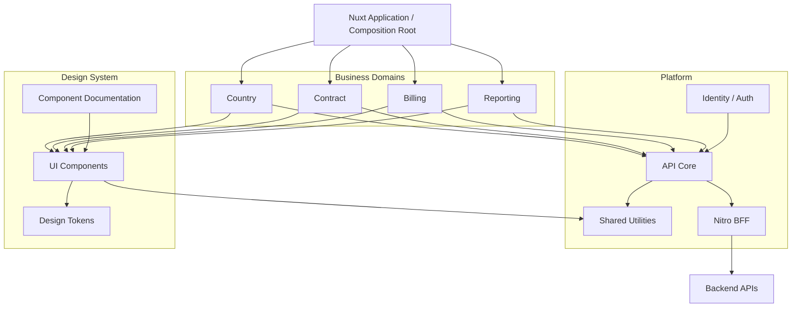
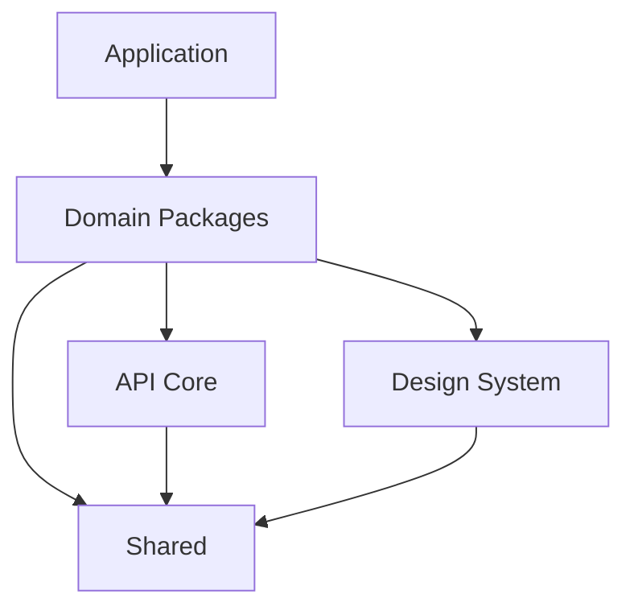
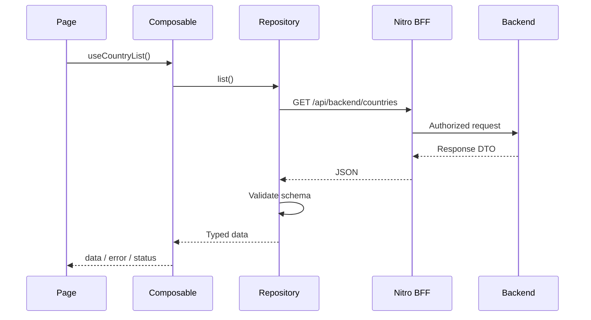

# Nuxt 3 Enterprise Modular Architecture

**Version:** 2.0  
**Status:** Proposed — Architecture Decision  
**Target:** Nuxt 3, TypeScript, pnpm Workspace  
**Team size:** 15–50+ developers  
**Architecture:** Domain-Driven Modular Monolith + Nuxt Layers + Design System

---

## 1. Executive Summary

### 1.1. Quyết định kiến trúc

Sử dụng một kiến trúc duy nhất:

**pnpm Workspace + Nuxt Layers + Domain-Oriented Packages + Shared Design System**

Trong đó:

- **pnpm Workspace** quản lý các package, dependency và workspace.
- **Nuxt Layers** lắp ghép các module có pages, components, composables, plugins và cấu hình Nuxt.
- **Domain-Oriented Packages** chia code theo nghiệp vụ thay vì chia toàn dự án theo loại file.
- **API Core** chuẩn hóa giao tiếp HTTP, lỗi, validation và authentication.
- **Design System** cung cấp tokens, UI components và quy tắc trải nghiệm thống nhất.
- **Nitro BFF** làm ranh giới giữa frontend và backend khi cần xử lý cookie, session và bảo mật.
- **CI/CD + CODEOWNERS + Dependency Rules** giúp nhiều team làm việc độc lập trong cùng repository.

Đây là **modular monolith ở frontend**, không phải micro-frontend.

### 1.2. Mục tiêu

1. Mỗi team sở hữu một hoặc nhiều domain.
2. Domain có thể phát triển và kiểm thử tương đối độc lập.
3. Tránh import chéo không kiểm soát.
4. Một Design System dùng chung.
5. API Client thống nhất và an toàn với SSR.
6. Dễ bổ sung nghiệp vụ mới.
7. Có thể tách domain thành package độc lập khi thật sự cần.
8. Tránh tạo quá nhiều abstraction cho những nghiệp vụ CRUD đơn giản.

### 1.3. Non-goals

Chưa triển khai:

- Micro-frontends.
- Module Federation.
- Nhiều ứng dụng frontend triển khai độc lập.
- Event bus toàn cục cho mọi giao tiếp giữa các domain.
- Repository/Service/UseCase bắt buộc cho từng endpoint.
- Nx hoặc Turborepo trước khi có nhu cầu tối ưu CI thực tế.

---

## 2. Đánh giá các phương án

| Phương án | Ưu điểm | Hạn chế | Quyết định |
|---|---|---|---|
| Nuxt Layers thuần | Dễ bắt đầu, tích hợp Nuxt tốt | Chưa có package boundaries rõ | Không chọn riêng lẻ |
| pnpm Workspace + Nuxt Layers | Cân bằng DX, module ownership, tái sử dụng | Cần lint dependency rules | **Chọn** |
| Nx + Nuxt Layers | Dependency graph, affected tasks, tooling mạnh | Tăng chi phí vận hành và học tập | Nâng cấp khi cần |
| Turborepo + Nuxt Layers | Task orchestration và cache tốt | Không tự giải quyết domain boundaries | Nâng cấp khi cần |
| Feature-Sliced Design | Quy tắc tổ chức frontend rõ | Không thay thế workspace hoặc Nuxt Layers | Tham khảo một phần |
| Full Clean Architecture | Tách domain logic và infrastructure tốt | Dễ quá nhiều boilerplate | Áp dụng có chọn lọc |
| Micro-Frontend | Triển khai độc lập theo team | Tăng độ phức tạp runtime, routing, shared UI | Chưa chọn |

**Lưu ý:** Đây không phải các phương án loại trừ hoàn toàn. Nx và Turborepo là công cụ workspace; DDD và Feature-Sliced Design là nguyên tắc tổ chức code; Nuxt Layers là cơ chế composition.

### 2.1. Tiêu chí quyết định

| Tiêu chí | Trọng số |
|---|---:|
| Dễ học và onboarding | 20% |
| Dễ maintain | 25% |
| Team ownership | 20% |
| Khả năng mở rộng | 15% |
| Testing và CI/CD | 10% |
| Khả năng tách package | 10% |

Trọng số phản ánh ưu tiên của dự án, không phải benchmark đo đạc giữa các framework.

### 2.2. Vì sao chọn phương án này?

Dự án hiện tại đã dùng `extends` và `src/packages`. Vì vậy, mở rộng thành pnpm Workspace giúp bổ sung package management và ranh giới phụ thuộc mà không cần viết lại toàn bộ ứng dụng.

Nuxt Layers tiếp tục chịu trách nhiệm tích hợp với Nuxt. Package exports và lint rules chịu trách nhiệm kiểm soát phụ thuộc. Hai cơ chế này bổ sung cho nhau.

---

## 3. Architecture Overview



### Nguyên tắc quan trọng

**Composition không đồng nghĩa với isolation.**

Nuxt Layers cho phép lắp ghép nhiều module vào một ứng dụng, nhưng không tự ngăn domain này import file nội bộ của domain khác.

Vì vậy, ranh giới module phải được kiểm soát bằng:

- Package exports.
- ESLint dependency rules.
- CODEOWNERS.
- CI checks.
- Architectural tests.
- Code review.

---

## 4. Folder Structure — Target Architecture

```text
project-root/
│
├── .github/
│   ├── CODEOWNERS
│   └── workflows/
│       ├── quality.yml
│       ├── test.yml
│       └── deploy.yml
│
├── config/
│   ├── nuxt/
│   │   ├── layers.ts
│   │   ├── route-rules.ts
│   │   └── modules.ts
│   ├── eslint/
│   └── testing/
│
├── docs/
│   ├── ARCHITECTURE.md
│   ├── DESIGN_SYSTEM.md
│   ├── API_CONVENTIONS.md
│   ├── MODULE_GUIDELINES.md
│   └── adr/
│       ├── 0001-modular-architecture.md
│       ├── 0002-api-client.md
│       └── 0003-design-system.md
│
├── server/
│   ├── api/
│   │   └── backend/
│   │       └── [...path].ts
│   ├── middleware/
│   └── utils/
│
├── src/
│   ├── app.vue
│   ├── pages/
│   │   └── index.vue
│   ├── layouts/
│   │   └── default.vue
│   │
│   └── packages/
│       │
│       ├── api-core/
│       │   ├── src/
│       │   │   ├── client/
│       │   │   ├── errors/
│       │   │   ├── schemas/
│       │   │   └── index.ts
│       │   ├── package.json
│       │   └── tsconfig.json
│       │
│       ├── shared/
│       │   ├── src/
│       │   │   ├── constants/
│       │   │   ├── utils/
│       │   │   ├── types/
│       │   │   └── index.ts
│       │   └── package.json
│       │
│       ├── design-system/
│       │   ├── src/
│       │   │   ├── assets/
│       │   │   │   └── css/
│       │   │   │       ├── tokens.css
│       │   │   │       └── main.css
│       │   │   ├── components/
│       │   │   │   ├── DsButton.vue
│       │   │   │   ├── DsInput.vue
│       │   │   │   ├── DsDialog.vue
│       │   │   │   └── DsDataTable.vue
│       │   │   └── composables/
│       │   ├── nuxt.config.ts
│       │   ├── package.json
│       │   └── tsconfig.json
│       │
│       ├── identity/
│       │   ├── src/
│       │   │   ├── api/
│       │   │   ├── composables/
│       │   │   ├── middleware/
│       │   │   ├── schemas/
│       │   │   └── pages/
│       │   ├── nuxt.config.ts
│       │   └── package.json
│       │
│       ├── country/
│       │   ├── src/
│       │   │   ├── api/
│       │   │   ├── application/
│       │   │   ├── components/
│       │   │   ├── composables/
│       │   │   ├── constants/
│       │   │   ├── pages/
│       │   │   ├── schemas/
│       │   │   ├── types/
│       │   │   └── public.ts
│       │   ├── nuxt.config.ts
│       │   ├── package.json
│       │   ├── tsconfig.json
│       │   └── vitest.config.ts
│       │
│       ├── contract/
│       ├── billing/
│       └── reporting/
│
├── nuxt.config.ts
├── pnpm-workspace.yaml
├── package.json
├── tsconfig.json
├── eslint.config.mjs
└── .env.example
```

### 4.1. Phân loại package

| Loại | Ví dụ | Có `nuxt.config.ts`? |
|---|---|---|
| Pure TypeScript | api-core, shared | Không |
| Nuxt infrastructure layer | identity | Có |
| Design System layer | design-system | Có |
| Business domain layer | country, billing | Có |

**Không phải package nào cũng cần là Nuxt Layer.**

Những package chỉ chứa types, utilities, schema hoặc logic TypeScript nên giữ độc lập với Nuxt để dễ kiểm thử và tái sử dụng.

### 4.2. Tương thích source hiện tại

Các package `common`, `country` đang tồn tại không cần đổi tên ngay.

Lộ trình khuyến nghị:

1. Giữ `country` như hiện tại.
2. Trích xuất HTTP infrastructure từ `common` sang `api-core`.
3. Trích xuất utilities thuần sang `shared`.
4. Tạo `design-system`.
5. Di chuyển từng domain khi đã có tests.
6. Chỉ xóa `common` sau khi các phụ thuộc đã được thay thế.

---

## 5. Configuration Strategy

### 5.1. pnpm-workspace.yaml

```yaml
packages:
  - "src/packages/*"
```

### 5.2. config/nuxt/layers.ts

```ts
export const applicationLayers = [
  './src/packages/design-system',
  './src/packages/identity',
  './src/packages/country',
  './src/packages/contract',
  './src/packages/billing',
  './src/packages/reporting',
]
```

Danh sách này là composition manifest của ứng dụng.

Không tự động load tất cả thư mục trong `src/packages`, vì điều đó khiến việc bật/tắt module và kiểm soát thứ tự trở nên khó dự đoán.

### 5.3. Root nuxt.config.ts

```ts
import { applicationLayers } from './config/nuxt/layers'

export default defineNuxtConfig({
  srcDir: './src',

  // Giữ Nitro server ở root, không phụ thuộc srcDir.
  serverDir: './server',

  extends: applicationLayers,

  runtimeConfig: {
    apiBaseUrl: '',

    public: {
      apiPrefix: '/api/backend',
    },
  },

  typescript: {
    strict: true,
  },
})
```

### 5.4. Domain nuxt.config.ts

```ts
export default defineNuxtConfig({
  srcDir: './src',
})
```

Domain layer nên có cấu hình tối thiểu.

Không để từng domain tùy ý thay đổi:

- Runtime config toàn hệ thống.
- Router configuration toàn cục.
- Authentication toàn cục.
- Global CSS.
- Security headers.
- Các Nuxt modules dùng chung.

Những cấu hình đó do root application hoặc platform team sở hữu.

### 5.5. Lưu ý Nuxt Layers

- Tránh trùng tên pages, components, composables và plugins.
- Đặt prefix cho components của từng domain khi cần.
- Không giả định alias `~` hoặc `@` luôn trỏ đến thư mục của layer đang viết.
- Sử dụng package imports hoặc relative imports rõ ràng cho code dùng chung.
- Kiểm thử thứ tự ưu tiên của các layer trong ứng dụng thật.
- Không đặt Nitro server routes trong layer trước khi xác nhận cơ chế scan và cấu hình `serverDir`.

**Quyết định:** Nitro BFF được đặt tại `server/` của root application để giảm rủi ro cấu hình và dễ quản lý security.

---

## 6. Domain Package Standard

Mỗi domain được chia thành các phần sau:

```text
country/
└── src/
    ├── api/
    │   └── country.repository.ts
    ├── application/
    │   └── create-country.ts
    ├── components/
    │   ├── CountryForm.vue
    │   └── CountryTable.vue
    ├── composables/
    │   ├── useCountryList.ts
    │   └── useCountryCommands.ts
    ├── constants/
    ├── pages/
    │   └── countries/
    │       └── index.vue
    ├── schemas/
    │   └── country.schema.ts
    ├── types/
    └── public.ts
```

### 6.1. Trách nhiệm từng thư mục

| Folder | Trách nhiệm |
|---|---|
| `api/` | Giao tiếp với backend |
| `application/` | Điều phối các use case phức tạp |
| `components/` | UI đặc thù nghiệp vụ |
| `composables/` | Reactive state và integration với Vue/Nuxt |
| `constants/` | Constants thuộc domain |
| `pages/` | Route entry points |
| `schemas/` | Validation và API contracts |
| `types/` | Types không sinh trực tiếp từ schema |
| `public.ts` | Public interface của domain |

### 6.2. Không bắt buộc mọi folder

CRUD đơn giản có thể chỉ cần:

```text
country/
└── src/
    ├── api/
    ├── composables/
    ├── components/
    ├── schemas/
    └── pages/
```

Chỉ thêm `application/` khi nghiệp vụ có orchestration, nhiều bước hoặc business rules đáng kể.

### 6.3. Design patterns áp dụng

**Repository Pattern**

Dùng cho abstraction của API hoặc data source.

**Adapter Pattern**

Dùng để chuyển đổi DTO từ backend thành model frontend khi cần.

**Dependency Inversion**

Domain phụ thuộc vào interface hoặc public contract, không phụ thuộc implementation nội bộ của domain khác.

**Composition Pattern**

Nuxt Layers lắp ghép các module vào ứng dụng.

**Facade Pattern**

Mỗi domain cung cấp một public API đơn giản cho module khác.

**Strategy Pattern**

Chỉ sử dụng khi có nhiều thuật toán hoặc hành vi có thể thay thế.

Không sử dụng Design Patterns chỉ để tăng số lượng class và file.

---

## 7. Dependency Rules

### 7.1. Hướng phụ thuộc



### 7.2. Quy tắc

**Được phép:**

```ts
import { countrySchema } from '@org/country'
import { ApiClientError } from '@org/api-core'
```

**Không được phép:**

```ts
import { internalHelper } from
  '../../billing/src/application/internal-helper'
```

Domain không được import trực tiếp file nội bộ của domain khác.

### 7.3. Cross-domain communication

Ưu tiên theo thứ tự:

1. Public interface của domain.
2. Shared contract được thống nhất.
3. Application-level orchestration.
4. Backend API khi dữ liệu thuộc domain khác.

Không tạo một `shared` khổng lồ chứa business logic của tất cả domain.

### 7.4. Package public API

Ví dụ `country/src/public.ts`:

```ts
export {
  countrySchema,
  countryListSchema,
} from './schemas/country.schema'

export type {
  Country,
} from './schemas/country.schema'
```

Trong `package.json`, chỉ export những phần được phép sử dụng bên ngoài.

Không export toàn bộ `src/**`.

### 7.5. Kiểm soát tự động

CI phải phát hiện:

- Circular dependencies.
- Import vượt package boundary.
- Import trực tiếp vào internal files.
- Dependency không được khai báo.
- Duplicate package versions không cần thiết.

Có thể sử dụng ESLint rules và dependency-cruiser.

---

## 8. API Architecture

### 8.1. Request flow



### 8.2. Quy tắc data fetching

**Đọc dữ liệu khi SSR:**

- `useFetch`.
- `useAsyncData`.
- `useRequestFetch` khi thực hiện request nội bộ cần forwarding request context.

**Thao tác từ sự kiện người dùng:**

- `$fetch`.
- Repository commands.

**Không sử dụng `$fetch` trực tiếp trong page setup cho SSR data loading** nếu điều đó gây request lặp hoặc mất lợi ích hydration.

### 8.3. API response contract

Ví dụ backend envelope:

```ts
type ApiSuccess<T> = {
  success: true
  data: T
  message?: string
}

type ApiFailure = {
  success: false
  code?: string
  message: string
  errors?: Record<string, string[]>
}
```

API Core chịu trách nhiệm:

- Request options.
- Timeout.
- Error normalization.
- Request ID / correlation ID.
- Validation integration.
- Envelope parsing.
- Xử lý 401, 403, 404, 422, 429, 5xx.

### 8.4. Schema ownership

Schema thuộc domain nào thì đặt tại domain đó.

Ví dụ:

```ts
import { z } from 'zod'

export const countrySchema = z.object({
  id: z.string(),
  code: z.string(),
  name: z.string(),
})

export const countryListSchema =
  z.array(countrySchema)

export type Country =
  z.infer<typeof countrySchema>
```

Không gom tất cả schemas vào `common`.

### 8.5. DTO và Domain Model

Không cần tạo DTO và Domain Model riêng cho mọi endpoint.

Chỉ tách khi:

- Backend contract khác đáng kể với dữ liệu UI.
- Cần chuẩn hóa nhiều backend.
- Có logic chuyển đổi dữ liệu phức tạp.
- Backend thay đổi thường xuyên và cần adapter ổn định.

### 8.6. SSR và authentication

BFF nên sử dụng same-origin endpoints.

Yêu cầu:

- Cookie có `HttpOnly`, `Secure` và `SameSite` phù hợp.
- Không đưa secret vào `runtimeConfig.public`.
- Không lưu access token nhạy cảm trong localStorage theo mặc định.
- Kiểm tra CSRF với mutation dùng cookie authentication.
- Không tạo open proxy nhận arbitrary upstream URL.
- Không forward mọi header/cookie tới upstream không tin cậy.
- Phân biệt authentication và authorization.

---

## 9. Design System Architecture

### 9.1. Nguyên tắc

Design System là một sản phẩm nội bộ có owner, version, tài liệu và quy trình review.

Không chỉ là thư mục `components/`.

### 9.2. Ba cấp độ tokens

**Primitive tokens**

Giá trị cơ sở như màu sắc, spacing, radius.

**Semantic tokens**

Ý nghĩa sử dụng như `background-primary`, `text-muted`, `border-danger`.

**Component tokens**

Giá trị áp dụng cho một component cụ thể.

Ví dụ:

```css
:root {
  --color-blue-600: #2563eb;

  --ds-color-primary: var(--color-blue-600);
  --ds-color-background: #ffffff;
  --ds-color-text: #111827;

  --ds-radius-sm: 0.375rem;
  --ds-radius-md: 0.5rem;

  --ds-space-1: 0.25rem;
  --ds-space-2: 0.5rem;
  --ds-space-4: 1rem;
}
```

### 9.3. Component tiers

| Tier | Ví dụ | Owner |
|---|---|---|
| Foundations | Colors, typography, spacing | Design System |
| Primitives | Button, Input, Dialog | Design System |
| Composites | DataTable, FilterPanel | Design System |
| Domain Components | CountryForm, BillingSummary | Domain team |
| Page Templates | AdminListPage | Shared UI / App |

### 9.4. Naming conventions

Design System components:

```text
DsButton
DsInput
DsDialog
DsDataTable
DsPagination
```

Domain components:

```text
CountryForm
CountryTable
BillingInvoiceCard
ContractApprovalPanel
```

Không đưa nghiệp vụ `Country`, `Billing`, `Contract` vào Design System.

### 9.5. Component API

Mỗi component public cần:

- Props có type rõ ràng.
- Events có type rõ ràng.
- Slots được tài liệu hóa.
- Keyboard interaction.
- Focus states.
- Loading, disabled và error states.
- Accessibility requirements.
- Visual regression coverage với component quan trọng.

### 9.6. Công cụ đề xuất

- **Nuxt UI:** nền tảng UI components nếu phù hợp với stack hiện tại.
- **Tailwind CSS:** utility styling.
- **CSS variables:** semantic design tokens.
- **Storybook:** component documentation và isolated development.
- **Vitest:** unit/component tests.
- **Playwright:** E2E và visual regression.
- **Figma:** nguồn thiết kế được đồng bộ qua quy trình review.

Có thể dùng Nuxt UI làm nền tảng nhưng vẫn cung cấp public components `Ds*` để domain không phụ thuộc trực tiếp vào implementation của thư viện UI.

### 9.7. Design governance

Một thay đổi Design System phải xem xét:

1. API compatibility.
2. Visual impact.
3. Accessibility.
4. Migration impact.
5. Documentation.
6. Tests.

Breaking changes phải có migration guide.

---

## 10. State Management

### 10.1. Phân loại state

| Loại | Giải pháp |
|---|---|
| Server state | useFetch / useAsyncData |
| Local component state | ref / reactive |
| Shared domain state | Domain composables / Pinia |
| Session state | Identity module |
| URL state | Route query |
| Persistent preferences | Storage abstraction |

### 10.2. Quy tắc

Không dùng Pinia cho mọi API response.

Ưu tiên server state của Nuxt cho dữ liệu tải từ backend.

Dùng Pinia khi state cần chia sẻ và thay đổi liên tục giữa nhiều component hoặc route.

Store thuộc domain nào đặt trong domain đó.

---

## 11. Testing Strategy

### 11.1. Testing pyramid

**Unit tests**

- Validation schemas.
- Pure utilities.
- Business rules.
- Data adapters.

**Component tests**

- Design System.
- Domain forms.
- Error and loading states.

**Integration tests**

- Repository + mocked backend.
- API error mapping.
- Authentication flow.
- Nitro BFF.

**E2E tests**

- Login.
- Permission checks.
- Critical business flows.
- Cross-domain workflows.

### 11.2. SSR test cases bắt buộc

- SSR fetch có cookie.
- Hydration không tạo request dư thừa.
- API 401 xử lý đúng.
- API 422 hiển thị validation errors.
- Backend timeout.
- Backend trả dữ liệu sai schema.
- Không lộ private runtime config.
- BFF không hoạt động như open proxy.

### 11.3. Quality gates

Pull request không được merge nếu:

- Typecheck fail.
- Lint fail.
- Unit tests fail.
- Dependency boundary check fail.
- Critical integration tests fail.

---

## 12. Team Ownership

### 12.1. Ownership model

| Team | Ownership |
|---|---|
| Platform Team | api-core, auth infrastructure, BFF, CI |
| Design System Team | tokens, components, accessibility |
| Country Team | country |
| Contract Team | contract |
| Billing Team | billing |
| Reporting Team | reporting |

Một team có thể sở hữu nhiều domain.

### 12.2. CODEOWNERS

Ví dụ:

```text
/src/packages/api-core/       @org/platform
/src/packages/shared/         @org/platform
/src/packages/design-system/  @org/design-system
/src/packages/identity/       @org/platform
/src/packages/country/        @org/country
/src/packages/contract/       @org/contract
/src/packages/billing/        @org/billing
/src/packages/reporting/      @org/reporting
/server/                      @org/platform
```

Thay `@org/...` bằng GitHub teams thực tế.

### 12.3. Quy trình thay đổi public API

1. Tạo proposal hoặc ADR nếu ảnh hưởng nhiều domain.
2. Xác định consumer packages.
3. Review với package owner.
4. Thêm tests.
5. Cập nhật documentation.
6. Có migration guide nếu breaking change.

---

## 13. CI/CD và Build Strategy

### Giai đoạn đầu

Sử dụng pnpm scripts và CI workflows thông thường:

```json
{
  "scripts": {
    "dev": "nuxt dev",
    "build": "nuxt build",
    "typecheck": "nuxt typecheck",
    "lint": "eslint .",
    "test": "vitest run",
    "test:e2e": "playwright test"
  }
}
```

### Khi repository lớn hơn

Đánh giá Nx hoặc Turborepo khi xuất hiện:

- CI chậm đáng kể.
- Nhiều ứng dụng cùng dùng workspace.
- Nhiều package build độc lập.
- Cần affected task execution.
- Cần distributed caching.
- Cần dependency graph phục vụ quản trị.

**Không nâng cấp chỉ vì số lượng developer tăng.**

Quyết định phải dựa trên dữ liệu về build time, CI duration và số lượng package.

---

## 14. Package Versioning

### Internal packages

Giai đoạn đầu sử dụng workspace dependencies:

```json
{
  "dependencies": {
    "@org/api-core": "workspace:*",
    "@org/shared": "workspace:*"
  }
}
```

### Khi tách package

Áp dụng:

- Explicit exports.
- Semantic versioning.
- Changelog.
- Contract tests.
- Deprecation policy.
- Automated release.

Không cần publish tất cả packages lên npm registry ngay.

---

## 15. Migration Plan

### Phase 1 — Establish Boundaries

- Giữ nguyên ứng dụng Nuxt 3.
- Thêm pnpm Workspace.
- Chuẩn hóa package names.
- Thiết lập ESLint và CODEOWNERS.
- Viết ADR kiến trúc.
- Thêm dependency checks.

**Kết quả:** Không thay đổi hành vi ứng dụng.

### Phase 2 — Extract Platform

- Tách API Core từ common.
- Chuẩn hóa error handling.
- Chuẩn hóa schema validation.
- Chuẩn hóa Nitro BFF.
- Thêm SSR integration tests.

**Kết quả:** Các domain dùng cùng một API contract.

### Phase 3 — Establish Design System

- Tạo semantic tokens.
- Tạo `DsButton`, `DsInput`, `DsDialog`.
- Tạo Storybook.
- Thêm accessibility và visual tests.
- Chuyển dần shared UI components.

**Kết quả:** Giao diện thống nhất, tránh duplicate components.

### Phase 4 — Modularize Domains

- Chuẩn hóa `country`.
- Áp dụng template cho `contract`, `billing`, `reporting`.
- Tạo public API.
- Ngăn deep imports.
- Thêm domain tests.

**Kết quả:** Các team phát triển tương đối độc lập.

### Phase 5 — Optimize Delivery

- Đo CI duration.
- Đo build performance.
- Phân tích dependency graph.
- Chỉ thêm Nx/Turborepo khi có lợi ích rõ.
- Xem xét tách ứng dụng nếu business cần deploy độc lập.

---

## 16. Definition of Done cho một Domain

Một domain được coi là đạt chuẩn khi:

- [ ] Có owner rõ ràng.
- [ ] Có package.json.
- [ ] Có Nuxt Layer nếu cần tích hợp pages/components.
- [ ] Không import nội bộ domain khác.
- [ ] Có public API rõ ràng.
- [ ] API responses được validate ở boundary cần thiết.
- [ ] Có unit tests cho logic quan trọng.
- [ ] Có integration tests cho API flow.
- [ ] Có SSR tests nếu domain hỗ trợ SSR.
- [ ] Sử dụng Design System.
- [ ] Không hardcode secret.
- [ ] Có tài liệu sử dụng.
- [ ] CI quality gates đạt yêu cầu.

---

## 17. Architecture Decision Record

### ADR-0001: Enterprise Modular Nuxt Architecture

**Status:** Proposed

**Context**

Ứng dụng Nuxt 3 có nhiều nghiệp vụ, nhiều team và đang sử dụng Nuxt Layers thông qua `extends`.

Cần cải thiện module boundaries, khả năng kiểm thử, team ownership và tái sử dụng UI.

**Decision**

Chọn:

**pnpm Workspace + Nuxt Layers + Domain-Oriented Modular Monolith + Shared Design System.**

**Consequences**

Tích cực:

- Migration ít rủi ro.
- Giữ được Nuxt conventions.
- Dễ onboard developer.
- Có package boundaries rõ hơn.
- Dễ mở rộng nghiệp vụ.
- Không yêu cầu micro-frontend infrastructure.
- Có lộ trình chuyển sang monorepo tooling nâng cao.

Đánh đổi:

- Vẫn triển khai một Nuxt application chính.
- Không có deploy độc lập cho từng domain.
- Nuxt Layers không tự bảo vệ dependency boundaries.
- Cần governance và lint rules.
- Design System cần owner và quy trình quản lý.

**Revisit conditions**

Đánh giá lại khi:

- Có nhiều frontend applications độc lập.
- Cần release cadence riêng cho từng sản phẩm.
- CI trở thành bottleneck.
- Có nhu cầu phân tách deployment thực sự.
- Domain ownership thay đổi đáng kể.

---

## 18. Coding Conventions

### File naming

```text
country.schema.ts
country.repository.ts
useCountryList.ts
useCountryCommands.ts
CountryForm.vue
CountryTable.vue
```

### Import rules

- Prefer explicit imports for cross-package dependencies.
- Use Nuxt auto-imports cho các Nuxt composables tiêu chuẩn.
- Không phụ thuộc vào auto-import cho public API giữa các package.
- Không tạo circular dependencies.
- Không import từ đường dẫn `src` nội bộ của package khác.

### Error handling

- Transport errors thuộc API Core.
- Domain validation thuộc domain.
- UI error presentation thuộc Design System.
- Business error messages thuộc domain.

### Business logic

Không đặt business rules phức tạp trong:

- Vue templates.
- Nitro proxy.
- Global plugins.
- Shared utilities.

---

## 19. Các quyết định cần giữ ổn định

1. Một Nuxt application làm composition root.
2. Một Design System chung.
3. Một API Core chung.
4. Mỗi domain có owner và public interface.
5. Không import chéo vào internals.
6. BFF thuộc platform/application boundary.
7. Domain đơn giản không bị ép dùng full Clean Architecture.
8. Tooling phức tạp chỉ bổ sung khi có số liệu chứng minh cần thiết.

---

## 20. References

### Official documentation

- Nuxt Layers: https://nuxt.com/docs/3.x/getting-started/layers
- Nuxt Data Fetching: https://nuxt.com/docs/3.x/getting-started/data-fetching
- Nuxt useFetch: https://nuxt.com/docs/3.x/api/composables/use-fetch
- Nuxt Directory Structure: https://nuxt.com/docs/3.x/directory-structure
- pnpm Workspace: https://pnpm.io/workspaces
- TypeScript Project References: https://www.typescriptlang.org/docs/handbook/project-references.html
- Storybook: https://storybook.js.org/docs
- Playwright: https://playwright.dev/docs/intro
- Vitest: https://vitest.dev/guide/
- Zod: https://zod.dev/
- Nx: https://nx.dev/
- Turborepo: https://turborepo.com/docs
- Feature-Sliced Design: https://feature-sliced.design/

### Research note

Tài liệu này là kiến trúc đề xuất dựa trên các nguyên tắc và công cụ nêu trên.

Các nhận định về quy mô vận hành thực tế của từng dự án open-source, hiệu quả CI hoặc số lượng developer chưa được xác nhận bằng benchmark trong tài liệu này. Cần bổ sung kết quả Deep Research và các case study có nguồn trước khi coi đây là báo cáo so sánh thực nghiệm hoàn chỉnh.

---

## Final Recommendation

**Adopt: pnpm Workspace + Nuxt Layers + Domain-Driven Modular Monolith + Shared Design System.**

Giữ Nuxt 3 và `src/packages` hiện tại.

Ưu tiên triển khai:

1. Package boundaries.
2. API Core.
3. Design System.
4. Domain ownership.
5. Testing và CI governance.

Không chuyển sang Micro-Frontend, Nx hoặc Turborepo ở giai đoạn đầu nếu chưa có nhu cầu cụ thể.

**Nguyên tắc cuối cùng: Kiến trúc phải giúp team phát triển nghiệp vụ nhanh hơn, không biến mỗi tính năng nhỏ thành một hệ thống phức tạp.**
